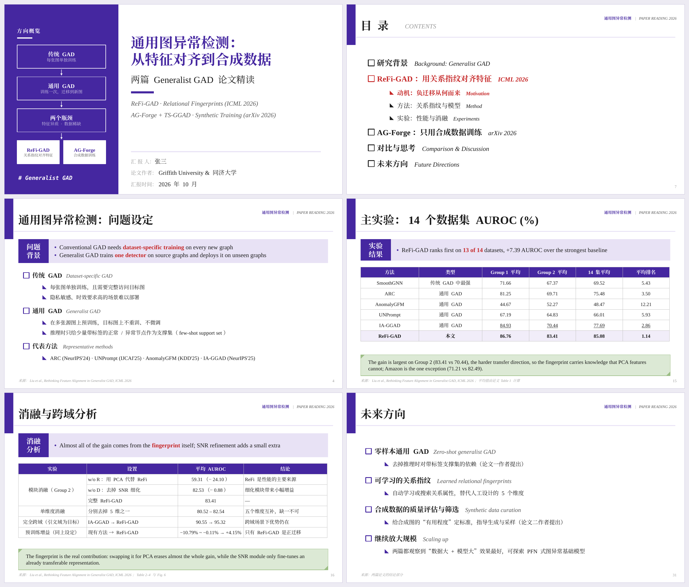

<div align="center">

# research-ppt-skill

组会论文汇报 PPT 的 Agent Skill

**版式交给代码，内容交给模型；上页面的每个数字都要能追到原文。**


[示例成品](demo/) · [工作原理](#工作原理) · [SKILL.md](research-report-cn/SKILL.md) · [进阶版](https://skillpay.alipay.com/shelf/product?productId=P0806000210832221&merchantId=2088242142310584)

</div>

这是一个 Agent Skill，任何能读 `SKILL.md`、能执行命令的 agent 都能用。输入 1–3 篇论文 PDF，或者一个研究方向的材料，输出一份研究组组会风格、可以直接编辑的 `.pptx`，附讲稿备注和逐页缩略图。



## 功能

- **固定的研究组版式**：紫色标签块、绿色结论条、每章前重复出现的目录（当前章节标红），中文宋体、西文 Times New Roman。版式全部由排版库生成，模型改不了。
- **先问再做**：开工前问 4 个问题，即放不放 logo、封面左栏放什么、汇报时长、要点用中文还是英文；说“按默认设置直接做”就跳过。
- **数据账本**：上页面的每个数字都记进 `numbers.md` 并写明出处，平均值和差值用代码算。和论文正文对不上时，先读附录、确认统计范围，再下结论。
- **论文配图**：脚本从 PDF 里定位并裁出框架图和关键现象图，去掉页眉、图题和白边。
- **排版自检**：生成前估算每页内容，放不下先自动压缩，仍然放不下就报出页码；警告清零才交付，最后渲染成图片逐页检查。
- **讲稿备注**：每个内容页带 1–2 句演讲者备注。

## 安装

把仓库地址交给你的 agent：

```text
帮我安装这个 skill：https://github.com/codezzzsleep/research-ppt-skill
```

安装就是把 `research-report-cn/` 文件夹放进 agent 的 skills 目录。

<details>
<summary>手动安装</summary>
<br>

克隆仓库后，把 `research-report-cn/` 复制到你所用 agent 的 skills 目录。以 Claude 为例：

- Claude Code：`cp -r research-ppt-skill/research-report-cn ~/.claude/skills/`
- Claude 网页版 / 桌面版：在设置中开启代码执行，从 [Releases](https://github.com/codezzzsleep/research-ppt-skill/releases) 下载 `research-report-cn.zip`，在 Skills 设置中上传。

</details>

运行环境需要 Node.js + pptxgenjs、Python 3 + Pillow、poppler-utils；LibreOffice 可选，用于渲染预览。安装命令写在 `SKILL.md` 里，agent 可以自己装。

## 使用

附上论文 PDF，然后说：

```text
用 research-report-cn 把这两篇论文做成组会精读 PPT，汇报 20 分钟。
```

开场的 4 个问题，不回答时用默认值：

| 问题 | 默认值 |
|---|---|
| 放不放单位 logo | 不放 |
| 封面左栏 | 方向概览图（另可选主题纹理、单位 logo） |
| 汇报时长 | 20–30 分钟 |
| 标签要点和结论条的语言 | 英文 |

交付的是 `.pptx` 和逐页缩略图，外加一段说明：用了哪些默认值，哪些地方还要你补，例如汇报人姓名。

## 工作原理

**模型只写内容脚本，版式由固定的排版库生成；数字先进账本，对过原文才上页面。**

读论文 → 数据账本 → 定大纲 → 裁配图 → 写内容脚本 → 构建（警告清零）→ 渲染检查 → 交付

| 问题 | 会发生什么 | 怎么防 |
|---|---|---|
| 版式漂移 | 换一个模型或换一次运行，风格就变 | 版式写死在排版库里，模型只写内容脚本 |
| 内容溢出 | 文字出框，表格压住结论条 | 生成前估算每页，放不下先压缩、再报出页码；警告清零才交付 |
| 数字出错 | 读错表格，心算平均值 | 表格对照页面图片核对；平均值、差值用代码算；数字进账本 |
| 误判论文 | 把统计范围不同当成数据矛盾 | 对不上先读附录，确认是不是同一组数据集和设定 |
| 配图不干净 | 带页眉、图题，坐标轴被裁掉 | 脚本按墨迹带定位、自动去白边，裁完逐张检查 |
| 交付后还要补 | 缺 logo、缺汇报人，默认值不合适 | 开场先问；没人回答就用默认值，并在交付时列出 |

## 示例

| 文件 | 内容 | 制作模型 |
|---|---|---|
| [GAD_demo.pptx](demo/GAD_demo.pptx) | 两篇图异常检测论文精读，32 页；论文配图为占位图 | Claude |
| [GAD_demo_by GPT 6.1 Sol.pdf](demo/GAD_demo_by%20GPT%206.1%20Sol.pdf) | 同样两篇论文，独立完成，32 页 | GPT 6.1 Sol |
| [AI_Agent_and_Harness_Survey_by DeepSeek v4.1 Flash.pptx](demo/AI_Agent_and_Harness_Survey_by%20DeepSeek%20v4.1%20Flash.pptx) | Agent / Harness 方向综述，33 页 | DeepSeek v4.1 Flash |

三份由不同模型用同一个 skill 生成，版式一致，内容取决于模型。综述那份涉及的数字没有逐条核对。

## 局限

- 预览用 LibreOffice 渲染，换行位置可能和 PowerPoint 略有差别，最终以 PowerPoint 为准。
- 没有安装宋体和 Times New Roman 的电脑会用替代字体显示。
- 版式由库固定，内容质量取决于所用模型。没有论文原图可裁时，模型自己画的示意图质量不稳定。
- 只输出 `.pptx`。

## 项目结构

```text
research-report-cn/        skill 本体，安装的就是这个文件夹
  SKILL.md                 给 agent 的流程、规范和 API
  assets/rr_lib.js         排版库：封面、目录、四种页面模板、字体修正、溢出检查
  assets/example_deck.js   完整示例：两篇论文的组会精读
  scripts/pdf_figures.py   从论文 PDF 定位、裁出配图
  scripts/preview.py       把 .pptx 渲染成逐页图片和缩略图总览
demo/                      不同模型做的成品
docs/                      README 用图
```

## 许可证

代码和文档采用 [MIT](LICENSE) 许可。示例中引用的论文内容和配图，版权归原作者。

---

<details>
<summary>English summary</summary>

An Agent Skill that turns 1–3 research papers (or material on a research topic) into an editable, Chinese lab-meeting style `.pptx` with speaker notes. It works with any agent that can read `SKILL.md` and run shell commands.

The model only writes a content script; a fixed layout library renders every slide, so decks look the same across models and runs. Every number on a slide is logged with its source in a data ledger and computed in code. Paper figures are cropped from the PDF by a script, and the build refuses to finish with layout warnings.

To install, give this repository's URL to your agent, or copy `research-report-cn/` into its skills directory. MIT licensed; quoted paper content and figures belong to their authors.

</details>
